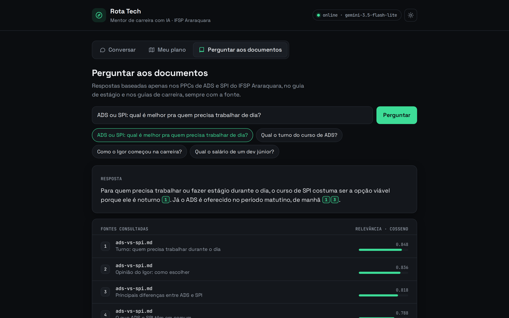
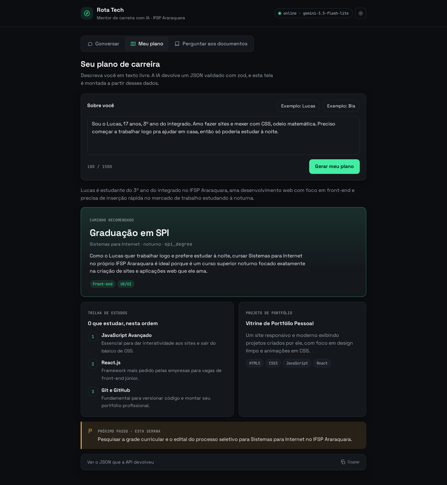
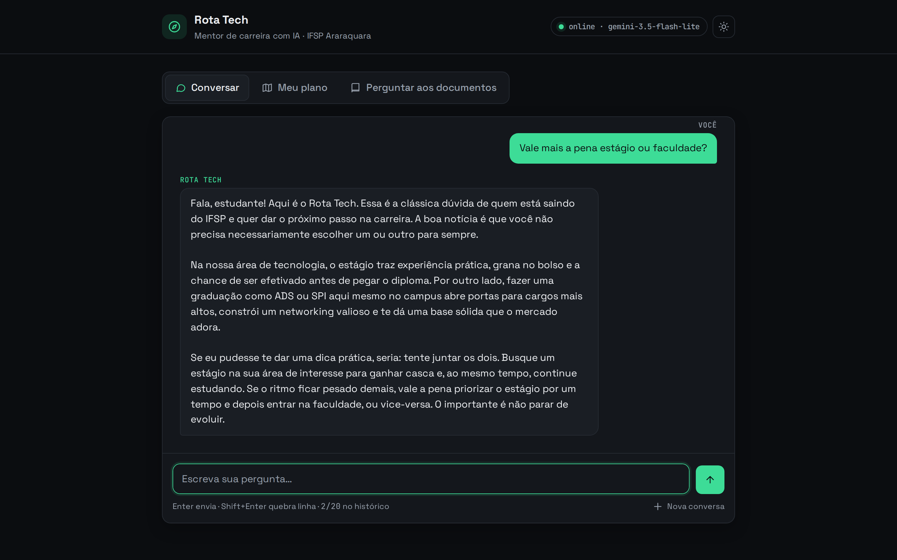
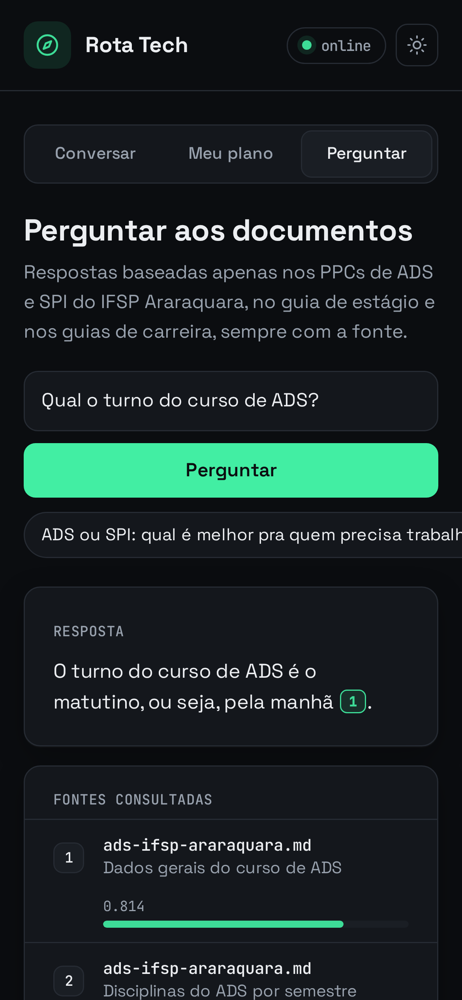
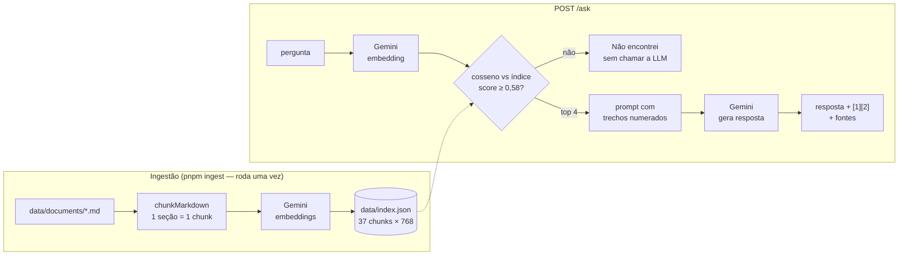

# 🧭 Rota Tech — mentor de carreira com IA

[](https://github.com/IgorSasaki/minicurso-ia-node-ifsp/actions/workflows/ci.yml)


Projeto do minicurso **"Desenvolvimento de Aplicações Inteligentes com Node.js e IA Generativa"**
📍 Semana da Informática · IFSP Araraquara
👨‍💻 Ministrante: **[Igor Sasaki](https://www.linkedin.com/in/igor-sasaki/)** — Engenheiro Full Stack Sênior · ex-Tech Lead · ex-aluno do Técnico em Informática do IFSP Araraquara

[](https://codespaces.new/IgorSasaki/minicurso-ia-node-ifsp)

---

## O que é

Uma API em **Node.js + TypeScript** que vai além do "chat com IA": integra o **Google Gemini** a uma aplicação de verdade, com três recursos.

| Recurso | Rota | O que demonstra |
|---|---|---|
| 💬 **Mentor de carreira** | `POST /chat` e `POST /chat/stream` | Persona via *system prompt*, histórico de conversa, streaming cancelável |
| 🗺️ **Plano de carreira em JSON** | `POST /career-plan` | Saída estruturada com JSON Schema + validação com **zod** |
| 📚 **Perguntas aos documentos (RAG)** | `POST /ask` | Embeddings, busca semântica e respostas **com citação de fonte** |

O RAG consulta documentos que o modelo nunca viu: os PPCs dos cursos de **Análise e Desenvolvimento de Sistemas (ADS)** e **Sistemas para Internet (SPI)** do IFSP Araraquara, um guia de estágio baseado na Lei do Estágio, um guia de primeiro emprego e a trajetória do ministrante.



<details>
<summary>📸 Mais telas</summary>

| Plano de carreira (JSON → interface) | Chat com streaming |
|---|---|
|  |  |

| Tema claro | Celular |
|---|---|
|  |  |

</details>

---

## Começando em 3 minutos

### Opção 1 — GitHub Codespaces (recomendado para a aula)
Nada para instalar: clique no botão **Open in GitHub Codespaces** acima. As dependências são instaladas sozinhas e o arquivo `.env` é criado automaticamente.

### Opção 2 — Na sua máquina
Pré-requisitos: **Node.js 22+** e **pnpm** (`corepack enable` já instala a versão certa).

```bash
git clone https://github.com/IgorSasaki/minicurso-ia-node-ifsp.git
cd minicurso-ia-node-ifsp
pnpm install
cp .env.example .env
```

### Configure a chave do Gemini
1. Crie uma chave gratuita em <https://aistudio.google.com/apikey> (conta Google, **sem cartão de crédito**).
2. Cole no `.env`:
   ```env
   GEMINI_API_KEY=sua_chave_aqui
   ```

> ⚠️ Os termos de uso da API do Gemini exigem **18 anos ou mais**. Na aula, quem é menor de idade faz em dupla com um colega maior.
> 🔒 A chave é uma senha: o `.env` está no `.gitignore` e nunca deve ir para o GitHub.

### Rode
```bash
pnpm hello    # etapa 1: primeira chamada ao Gemini no terminal
pnpm dev      # API + front-end em http://localhost:3333
pnpm check    # tipos + lint + testes
```

---

## As etapas do minicurso

Cada etapa é um commit com uma **tag git**. Ficou para trás? Pule direto para o código pronto:

```bash
git checkout etapa-03   # código pronto da etapa 3
git checkout main       # versão final
```

| Tag | Etapa | Conceitos | Guia |
|---|---|---|---|
| `etapa-01` | Primeira chamada à LLM | tokens, `systemInstruction`, temperatura | [📄](docs/steps/01-first-call.md) |
| `etapa-02` | API `/chat` com persona | Fastify, validação com zod, erros centralizados | [📄](docs/steps/02-chat-api.md) |
| `etapa-03` | JSON estruturado `/career-plan` | `responseJsonSchema`, schema como contrato | [📄](docs/steps/03-structured-output.md) |
| `etapa-04` | Embeddings e similaridade | vetores, similaridade de cosseno | [📄](docs/steps/04-embeddings.md) |
| `etapa-05` | Ingestão de documentos | chunking, sobreposição, índice vetorial | [📄](docs/steps/05-ingestion.md) |
| `etapa-06` | RAG completo `/ask` | top-K, score mínimo, fontes, prompt injection | [📄](docs/steps/06-rag.md) |
| `etapa-07` | Front-end e streaming | streaming cancelável, rate limit, UX, XSS | [📄](docs/steps/07-frontend.md) |
| `main` | Código de produção | testes, lint, CI | [📄](docs/steps/08-production.md) |

---

## Como funciona



### Endpoints

<details>
<summary><code>POST /chat</code> — conversa com o mentor</summary>

```bash
curl -s -X POST localhost:3333/chat -H 'Content-Type: application/json' -d '{
  "messages": [{ "role": "user", "text": "Vale mais a pena estágio ou faculdade?" }]
}'
```
```json
{ "answer": "Dá para fazer os dois! ..." }
```
`POST /chat/stream` recebe o mesmo corpo e devolve o texto em *streaming* (`text/plain`).
</details>

<details>
<summary><code>POST /career-plan</code> — plano de carreira em JSON validado</summary>

```bash
curl -s -X POST localhost:3333/career-plan -H 'Content-Type: application/json' -d '{
  "aboutMe": "Sou o Lucas, 17 anos, 3º ano do integrado. Amo CSS, odeio matemática. Preciso trabalhar logo, só posso estudar à noite."
}'
```
```json
{
  "profileSummary": "Lucas tem 17 anos...",
  "recommendedPath": "spi_degree",
  "rationale": "Como você precisa trabalhar durante o dia, o SPI à noite é ideal...",
  "interestAreas": ["front-end", "ux-ui"],
  "alternativePath": { "path": "job_market", "whenItFits": "..." },
  "studyPath": [{ "order": 1, "topic": "JavaScript", "reason": "...", "howToStart": "..." }],
  "skillsToDevelop": [{ "skill": "Comunicação", "kind": "soft", "why": "..." }],
  "milestones": [{ "horizon": "3_months", "goal": "..." }, { "horizon": "6_months", "goal": "..." }, { "horizon": "12_months", "goal": "..." }],
  "portfolioProject": { "title": "Portfólio Pessoal", "description": "...", "technologies": ["HTML5", "CSS3"] },
  "resources": [{ "name": "Documentação da MDN", "kind": "docs", "why": "..." }],
  "exploreNext": ["..."],
  "reflectionQuestions": ["..."],
  "nextStepThisWeek": "Criar um perfil no LinkedIn..."
}
```
</details>

<details>
<summary><code>POST /ask</code> — RAG com fontes</summary>

```bash
curl -s -X POST localhost:3333/ask -H 'Content-Type: application/json' \
  -d '{ "question": "Qual o turno do curso de ADS?" }'
```
```json
{
  "answer": "O curso de ADS é oferecido no turno matutino (manhã) [1].",
  "sources": [
    { "ref": 1, "file": "ads-ifsp-araraquara.md", "section": "Dados gerais do curso de ADS", "score": 0.814 }
  ]
}
```
</details>

`GET /health` devolve o status e o modelo em uso. Há requisições prontas em [`requests.http`](requests.http) (extensão REST Client do VS Code).

### Erros
Toda falha volta como `{ "error": "mensagem para o usuário" }`, com o status HTTP que a descreve — sem vazar detalhes internos (eles ficam no log do servidor).

| Status | Quando |
|---|---|
| `400` | corpo inválido (com `details` por campo) |
| `429` | limite de 15 chamadas de IA por minuto, ou cota do Gemini |
| `502` | o Gemini recusou a requisição ou devolveu JSON fora do schema |
| `503` / `504` | o Gemini está fora do ar / demorou demais |
| `500` | erro inesperado |

---

## Estrutura do projeto

```
├── src/                       # código da API
│   ├── server.ts              # ponto de entrada: carrega o índice e coloca no ar
│   ├── app.ts                 # buildApp(): monta o Fastify com dependências injetadas
│   ├── config/
│   │   ├── env.ts             # regras do .env (zod) — puro, testável
│   │   └── config.ts          # lê e valida o .env uma única vez
│   ├── ai/
│   │   ├── llm.ts             # createLlm(): chat, chatJson, chatStream
│   │   ├── gemini.ts          # cliente real do Gemini (único arquivo com a chave)
│   │   └── prompts.ts         # persona do mentor e prompts do RAG
│   ├── rag/
│   │   ├── embeddings.ts      # textos → vetores
│   │   ├── similarity.ts      # similaridade de cosseno
│   │   ├── chunker.ts         # documentos → chunks
│   │   ├── vector-store.ts    # salvar/carregar/validar o índice
│   │   └── retriever.ts       # busca dos trechos mais relevantes
│   ├── http/
│   │   ├── errors.ts          # tratamento central de erros
│   │   ├── validation.ts      # zod como validador do Fastify
│   │   ├── rate-limit.ts      # limite de chamadas de IA
│   │   └── routes/            # chat.ts, career-plan.ts, ask.ts
│   └── schemas/
│       └── career-plan.ts     # o contrato do plano de carreira
├── scripts/                   # programas de linha de comando (fora do servidor)
│   ├── 01-hello.ts            # etapa 1
│   ├── 04-similarity.ts       # etapa 4
│   └── ingest.ts              # etapa 5: gera data/index.json
├── public/                    # front-end (HTML, CSS e JS puros, sem build)
│   ├── index.html
│   ├── css/app.css
│   └── js/                    # main, api, dom, format, chat, career-plan, ask
├── test/                      # Vitest
│   ├── helpers/fakes.ts       # IA falsa: sem chave, sem internet, sem custo
│   ├── unit/
│   └── integration/
├── data/
│   ├── documents/             # corpus do RAG (markdown)
│   └── index.json             # índice vetorial gerado pelo pnpm ingest
└── docs/                      # guias das etapas e material do ministrante
```

## Scripts

| Comando | O que faz |
|---|---|
| `pnpm hello` | Primeira chamada ao Gemini (etapa 1) |
| `pnpm dev` | API + front com recarregamento automático |
| `pnpm start` | API sem recarregamento |
| `pnpm similarity` | Demonstração de embeddings (etapa 4) |
| `pnpm ingest` | Gera `data/index.json` a partir de `data/documents/` (etapa 5) |
| `pnpm test` / `pnpm test:watch` | Testes automatizados |
| `pnpm typecheck` | Verifica os tipos TypeScript |
| `pnpm lint` / `pnpm format` | Lint e formatação (Biome) |
| `pnpm check` | Tipos + lint + testes (o mesmo que o CI roda) |

## Configuração (`.env`)

| Variável | Padrão | Descrição |
|---|---|---|
| `GEMINI_API_KEY` | — | **Obrigatória.** Chave do Google AI Studio |
| `GEMINI_MODEL` | `gemini-3.5-flash-lite` | Modelo de geração (rápido, cota gratuita generosa) |
| `GEMINI_THINKING_LEVEL` | `MINIMAL` | Quanto o modelo "pensa": `MINIMAL`, `LOW`, `MEDIUM` ou `HIGH` |
| `GEMINI_EMBEDDING_MODEL` | `gemini-embedding-2` | Modelo de embeddings do RAG |
| `LLM_TIMEOUT_MS` | `30000` | Tempo máximo esperando a IA |
| `PORT` | `3333` | Porta da API |
| `LOG_LEVEL` | `info` | Nível de log (`debug`, `info`, `warn`...) |

## Padrões de código

| Padrão | Exemplo |
|---|---|
| Identificadores em **inglês**, `camelCase` | `createRetriever`, `chatJson`, `aboutMe` |
| Tipos e classes em `PascalCase` | `CareerPlan`, `InvalidResponseError` |
| Constantes em `UPPER_SNAKE_CASE` | `MIN_SCORE`, `AI_RATE_LIMIT` |
| Arquivos em `kebab-case` | `vector-store.ts`, `career-plan.ts` |
| Comentários e mensagens ao usuário em **português** | o código fala a língua do mercado; a explicação, a do time |

## Stack

| Peça | Escolha | Por quê |
|---|---|---|
| Runtime | Node.js 22 + `tsx` | TypeScript sem etapa de build |
| HTTP | Fastify 5 | rápido, simples, com plugins de rate limit e arquivos estáticos |
| IA | `@google/genai` (SDK oficial) | geração, JSON estruturado, streaming e embeddings num só SDK |
| Validação | zod 4 | um schema vira JSON Schema, validação e tipo TypeScript |
| Banco vetorial | `index.json` em memória | didático e sem infraestrutura; em produção, pgvector, Qdrant etc. |
| Qualidade | Vitest, Biome, GitHub Actions | testes rápidos, lint/formatação, CI a cada push |

---

## Problemas comuns

| Sintoma | Solução |
|---|---|
| `❌ Configuração inválida... GEMINI_API_KEY` | Rode `cp .env.example .env` e cole a chave |
| `502 Não foi possível falar com o provedor de IA` | A chave está inválida; copie de novo do AI Studio |
| `429` | Limite por minuto: aguarde 60 segundos |
| Servidor não sobe: `Índice não encontrado` | `pnpm ingest` |
| Servidor não sobe: `O índice foi gerado com ...` | Você trocou o modelo de embedding: `pnpm ingest` |
| `EADDRINUSE :3333` | Já existe um servidor rodando; feche-o ou mude a `PORT` |

Mais detalhes em [`docs/setup.md`](docs/setup.md).

## Faça o seu 🛠️

Este projeto foi feito para virar o **seu** projeto de portfólio:

1. Faça um **fork** deste repositório.
2. Troque os arquivos de `data/documents/` por um tema seu (regras de um jogo, cardápio da cantina, matérias do seu ano...), com seções `##` claras.
3. Ajuste a persona em `src/ai/prompts.ts`.
4. Rode `pnpm ingest` e teste no `/ask`.
5. Escreva o seu README e publique. Marque [@igor-sasaki](https://www.linkedin.com/in/igor-sasaki/) no LinkedIn!

## Documentação

- [Índice da documentação](docs/README.md) — guias das 8 etapas
- [Preparação do ambiente](docs/setup.md)
- Para o ministrante: [roteiro](docs/teaching/script.md) · [checklist](docs/teaching/checklist.md) · [plano B](docs/teaching/plan-b.md)

## Fontes do corpus

- [PPC do CST em Análise e Desenvolvimento de Sistemas — IFSP Araraquara](https://www.arq.ifsp.edu.br/superiores/tecnologia-em-analise-e-desenvolvimento-de-sistemas) (ingressantes a partir de 2023)
- [PPC do CST em Sistemas para Internet — IFSP Araraquara](https://www.arq.ifsp.edu.br/superiores/tecnologia-em-sistemas-para-internet) (2023)
- [Lei nº 11.788/2008 (Lei do Estágio)](https://www.planalto.gov.br/ccivil_03/_ato2007-2010/2008/lei/l11788.htm)
- Guias de carreira e trajetória: experiência do ministrante (marcados como opinião nos documentos)

> Os resumos dos PPCs foram preparados para fins didáticos. Para informações oficiais e atualizadas, consulte o site do IFSP Araraquara.

## Sobre o autor

**Igor Leonardo Sasaki da Silva Moreira** — Engenheiro Full Stack Sênior, ex-Tech Lead, com mais de 8 anos de experiência com Node.js, TypeScript, React, arquitetura de software e cloud. Técnico em Informática pelo IFSP Araraquara e tecnólogo em Segurança da Informação pela FATEC Araraquara. Professor e palestrante.

[LinkedIn](https://www.linkedin.com/in/igor-sasaki/) · [GitHub](https://github.com/IgorSasaki) · [Lattes](https://lattes.cnpq.br/0034940506327539)

## Licença

[MIT](LICENSE) — use, adapte e publique no seu portfólio.
